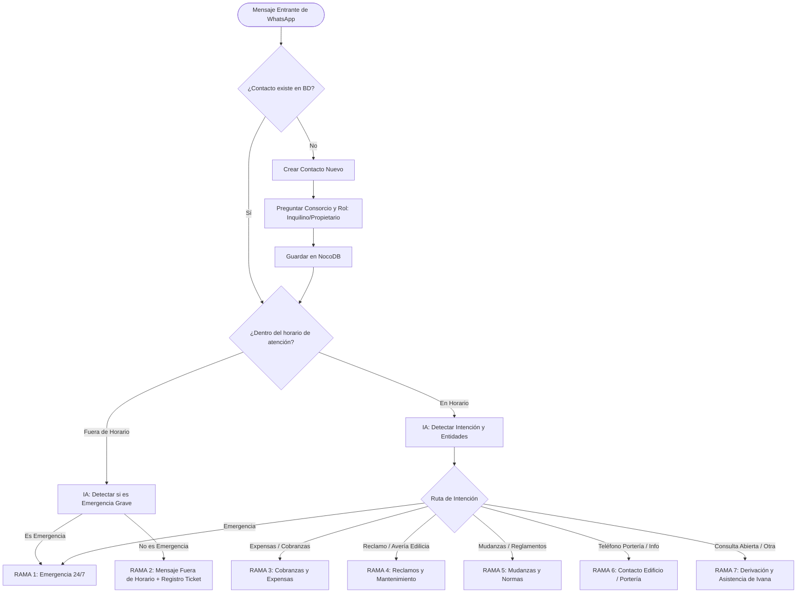

# Especificación del Árbol de Decisión y Flujos Operativos

Este documento formaliza las reglas de negocio, los estados de conversación y los flujos detallados del chatbot para el consorcio administrado por la **Dra. Ivana Seliz**.

---

## 1. Reglas de Negocio Fundamentales

1. **Horario de Atención:**
   - **Días hábiles:** Lunes a Viernes.
   - **Bloques:** 10:00 a 14:00 hs y 14:00 a 17:00 hs.
   - **Fuera de horario:** Noches (17:01 a 09:59 hs), fines de semana y feriados.
2. **Privacidad de Consorcios (Regla estricta):**
   - El chatbot **NUNCA** debe enumerar o exponer públicamente la lista de consorcios que administra Ivana a un usuario no identificado.
   - Si no se conoce el edificio del usuario, se le pregunta amablemente: *"¿A qué edificio/dirección pertenecés?"*.
3. **Identificación del Usuario:**
   - Debe registrarse en base de datos:
     - Teléfono (WhatsApp ID).
     - Nombre / Alias.
     - Rol: `Propietario` | `Inquilino` | `Inmobiliaria` | `Proveedor / Otro`.
     - Consorcio asignado (ej. *Corrientes y Lavalle*, *Callao 2334*, etc.).
     - Unidad Funcional / Piso y Depto.
4. **Modos de Decisión y Control Humano (según diseño en Obsidian):**
   - **Modo Básico (Determinístico - Fase 1):** El chatbot solo envía mensajes aprobados y predefinidos. Si una consulta no encaja, toma los datos, la registra como ticket en NocoDB y le avisa que la Dra. Seliz le responderá.
   - **Modo Intermedio (Asistido por IA - Fase 2):** Si la consulta no tiene plantilla exacta, la IA redacta un borrador de respuesta y lo guarda en la tabla `Respuestas_Pendientes_Aprobacion` en NocoDB. Ivana o su asistente pueden dar un clic a "Aprobar" y el webhook de Evolution API dispara el mensaje al vecino.
   - **Modo Avanzado (Fase 3):** Respuestas conversacionales automáticas acotadas estrictamente a reglamentos aprobados y preguntas frecuentes (FAQs validadas).

---

## 2. Diagrama General del Árbol de Decisión

---

## 3. Especificación de Ramas Operativas

### Rama 1: Emergencias Graves (24/7 sin excepción de horario)
- **Criterio de activación:** Incendio, inundación masiva o rotura de caño maestro, personas atrapadas en ascensor, olor a gas, peligro de derrumbe o corte eléctrico general del edificio.
- **Acción del Chatbot:**
  1. Envía de inmediato el mensaje de emergencia con los números de acción rápida:
     - Bomberos (100) / SAME (107) / Policía (911).
     - Proveedores de guardia correspondientes al consorcio (Ascensorista de turno, plomero de guardia, empresa de mantenimiento de bombas).
  2. Etiqueta al usuario como `EMERGENCIA_ACTIVA` en WhatsApp / Evolution API.
  3. Crea un ticket con `Prioridad: CRÍTICA` en NocoDB y envía una notificación push/alerta directa a Ivana.

### Rama 2: Fuera de Horario de Atención
- **Criterio de activación:** Mensajes recibidos de Lunes a Viernes de 17:01 a 09:59 hs, o Sábados, Domingos y Feriados, **que no sean emergencias**.
- **Acción del Chatbot:**
  1. Envía el mensaje informativo fuera de horario:
     > *"Hola, gracias por comunicarte con la administración de la Dra. Ivana Seliz. Te recordamos que nuestro horario de atención es de Lunes a Viernes de 10:00 a 14:00 y de 14:00 a 17:00 hs.*
     > *Tu consulta ha quedado registrada y te responderemos a la brevedad al iniciar la próxima jornada hábil."*
  2. Registra el mensaje en NocoDB con etiqueta `Fuera_De_Horario` para que no se pierda.

### Rama 3: Expensas y Cobranzas
- **Sub-intenciones recurrentes:**
  - **A. Pedido de CBU / Datos de Cuenta del Consorcio:**
    - El bot identifica el consorcio del usuario (ej. *Corrientes y Lavalle* o *Callao 2334*).
    - Entrega únicamente el CBU, Alias y CUIT de la cuenta oficial de ese edificio específico.
    - Recuerda el email de cobranzas para remitir el comprobante.
  - **B. Envío de Comprobante de Pago:**
    - Si el usuario adjunta una imagen o PDF de transferencia:
    - El bot descarga el archivo mediante Evolution API y lo adjunta al registro del consorcio en NocoDB.
    - Responde: *"Recibimos tu comprobante de pago para la unidad [Piso/Depto]. Lo derivamos al área de cobranzas para su imputación en la próxima liquidación."*
  - **C. Reclamo de Saldo o Deuda:**
    - Registra el reclamo contable y notifica plazo de revisión (48 a 72hs hábiles).

### Rama 4: Reclamos y Mantenimiento Edilicio
- **Sub-intenciones recurrentes:**
  - Filtración de agua en techo/pared.
  - Ascensor fuera de servicio o ruidos extraños.
  - Puerta de entrada rota, cerradura electromagnética trabada.
  - Luz quemada en palier / pasillos.
  - Problemas con cochera / portón levadizo / galería.
- **Pasos del flujo:**
  1. Verificar datos: ¿Tenemos el Piso y Depto? Si no, pedirlo.
  2. Solicitar evidencia: *"Por favor, si es posible, envianos una foto o video breve del problema para coordinar con el técnico correspondiente."*
  3. Generación de Ticket en NocoDB:
     - Campos: Consorcio, Unidad, Tipo de Avería, Descripción, URLs de Fotos, Estado = `PENDIENTE_REVISION`.
  4. Cierre del paso: Se le informa el número de reclamo interno y que el área técnica se contactará.

### Rama 5: Mudanzas y Reglamento Interno
- **Sub-intenciones recurrentes:**
  - Días y horarios autorizados para mudanza.
  - Seguro de accidentes personales (ART) para fleteros.
  - Reserva de quincho, SUM o parrilla.
  - Ruidos molestos o convivencia de mascotas.
- **Acción del Chatbot:**
  - Envía las pautas del reglamento del edificio correspondiente (ej. días permitidos de mudanza: Lunes a Viernes de 9 a 18hs, sábados de 9 a 13hs; uso obligatorio de cobertores en ascensor).

### Rama 6: Contacto de Portería e Información de Edificio
- **Sub-intenciones:**
  - Teléfono del encargado/portero.
  - Horarios de recolección de basura.
- **Acción:**
  - Envía la información de contacto del encargado del consorcio consultado.

---

## 4. Matriz de Estados de la Conversación (FSM)

| Estado | Evento Esperado | Siguiente Estado | Acción |
| :--- | :--- | :--- | :--- |
| `INIT` | Primer mensaje recibido | `CHECK_PROFILE` | Buscar número en NocoDB |
| `AWAITING_BUILDING` | Usuario responde con su consorcio | `AWAITING_UNIT` | Validar edificio y guardar |
| `AWAITING_UNIT` | Usuario indica piso/depto | `IDLE` | Guardar unidad |
| `IDLE` | Mensaje nuevo | `CLASSIFY_INTENT` | Clasificar intención con IA |
| `AWAITING_MEDIA_RECLAMO` | Envío de foto/video de avería | `TICKET_CREATED` | Descargar adjunto, crear ticket y agradecer |
| `AWAITING_PAYMENT_PROOF` | Envío de foto/PDF comprobante | `PROOF_LOGGED` | Guardar comprobante y notificar imputación |
