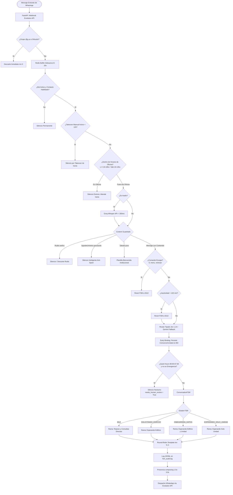
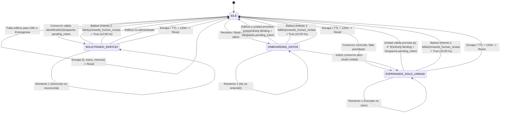

# Especificación del Árbol de Decisión, Flujos y FSM

Este documento formaliza las reglas de negocio, los estados de conversación y los flujos operativos del sistema de atención automatizada por WhatsApp para la administración de consorcios de la **Dra. Ivana Seliz**.

---

## 1. Reglas de Negocio Fundamentales

1. **Horarios Operativos y Silencio del Bot:**
   - **Horario de Oficina (Silencio Total del Bot):**
     - Lunes a Viernes de 10:00 a 18:00 hs.
     - Sábados de 10:00 a 13:00 hs.
     - *Regla:* Durante este horario atiende la Dra. Ivana Seliz personalmente desde su teléfono físico. El bot permanece en silencio estricto.
   - **Horario de Operación del Bot:**
     - Fuera del horario de oficina, domingos completos y feriados nacionales argentinos (`FERIADOS_AR`).
   - **Quiet Hours (00:00 a 07:30 hs):**
     - Silencio nocturno total para no despertar a los vecinos.
     - Los mensajes no urgentes se persisten con `needs_human_review = True` para revisión humana matutina a las 10:00 hs.
     - No se disparan ráfagas de respuestas automáticas a las 07:31 hs.
2. **Emergencias Críticas 24/7:**
   - Incendios, escape de gas, inundaciones graves o personas atrapadas en ascensor.
   - Operan las 24 horas sin importar el horario ni las Quiet Hours.
   - Si no se conoce el edificio, se entregan números públicos inmediatos (Bomberos 100, SAME 107, Policía 911) mientras se solicita la dirección con urgencia.
   - Si el edificio está identificado, se despachan los números de guardia técnica específicos (ascensorista, plomero de urgencia, portería).
3. **Privacidad de Consorcios (Regla Inquebrantable):**
   - El bot **NUNCA** lista ni enumera el padrón de consorcios administrados a un usuario no identificado.
   - Si falta el edificio, solicita calle y altura sin dar opciones.
4. **Cobranzas y Trámites de Pago:**
   - Cero pasarelas ni botones de pago en WhatsApp.
   - Todo comprobante se remite obligatoriamente al correo oficial del consorcio (`email_cobranzas`).
   - El bot entrega CBU, Alias, CUIT y cuenta oficial, pero no concilia pagos por WhatsApp.
5. **Takeover Humano (12 Horas de TTL):**
   - Si Ivana envía un mensaje manual desde su celular (`fromMe: true` no emitido por el bot), la conversación entra en silencio automático durante 12 horas.
6. **Early Binding de Perfil:**
   - En cuanto un mensaje revela un consorcio o unidad válidos, se persisten inmediatamente en la tabla `contactos` antes de evaluar la FSM, evitando preguntas repetitivas.
7. **Comandos de Escape:**
   - Si el usuario escribe `0`, `menu`, `reiniciar`, `inicio`, `cancelar` o `salir`, la FSM resetea su estado inmediatamente a `IDLE`, reinicia `retry_count = 0` y emite la plantilla cordial de reinicio.

---

## 2. Diagrama General del Árbol de Decisión

---

## 3. Especificación de Ramas Operativas

### Rama 1: Emergencia Crítica 24/7
- **Activación:** Fuego, escape de gas, inundación de columna principal, personas atrapadas en ascensor, derrumbe.
- **Acción:**
  - Si el usuario tiene consorcio registrado: entrega teléfonos de guardia técnica directa (portería, ascensorista, plomero de guardia) y números públicos de auxilio (100, 107, 911).
  - Si el usuario no tiene consorcio registrado: entrega números públicos y solicita con urgencia la dirección del edificio (`SOLICITANDO_EDIFICIO` con `pending_intent = EMERGENCIA`).
  - Persiste el mensaje y marca `needs_human_review = True` con prioridad `CRÍTICA`.

### Rama 2: Expensas y Cobranzas
- **Sub-flujo A: Pedido de CBU / Datos de Cuenta:**
  - Si el usuario tiene consorcio asignado: entrega CBU, Alias, CUIT, Titular y correo oficial de cobranzas.
  - Si el usuario no tiene consorcio: transiciona a `SOLICITANDO_EDIFICIO` con `pending_intent = EXPENSAS_DATOS_PAGO`.
- **Sub-flujo B: Aviso de Transferencia / Envío de Comprobante:**
  - El bot recuerda enviar el comprobante adjunto al correo oficial (`email_cobranzas`).
  - Si viene una imagen o PDF adjunto, se persiste en la conversación y se confirma su recepción para imputación contable.
- **Sub-flujo C: Reclamos de Saldo:**
  - Se registra el mensaje para análisis administrativo de Ivana a las 10:00 hs (`needs_human_review = True`).

### Rama 3: Reclamos y Mantenimiento Edilicio
- **Condición:**
  - Requiere consorcio y unidad funcional completos.
  - Si falta consorcio y unidad: transiciona a `ONBOARDING_DATOS`.
  - Si tiene consorcio pero falta unidad: transiciona a `ESPERANDO_SOLO_UNIDAD`.
  - Si tiene ambos: emite acuse de recibo formal confirmando que el reclamo fue registrado para evaluación por el equipo técnico a las 10:00 hs (`needs_human_review = True`).

### Rama 4: Mudanzas y Normas de Convivencia
- Si el consorcio tiene `pautas_mudanza` cargadas, se envían los horarios y requisitos de seguros de ART.
- Se marca para revisión humana si se solicita reserva de ascensor o coordinación con portería.

---

## 4. Máquina de Estados Finitos (`ConversationFSM`)

