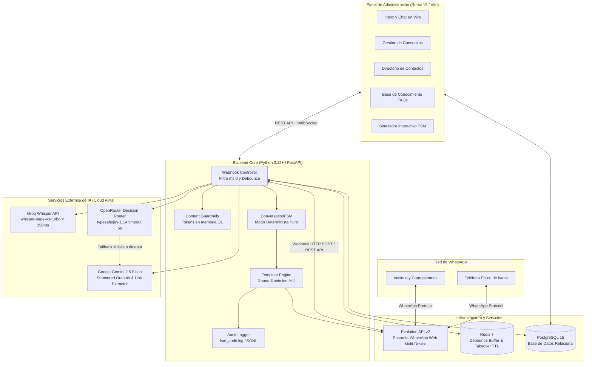

# Arquitectura Técnica — Chatbot Consorcios Dra. Ivana Seliz

Este documento detalla la arquitectura de software, infraestructura de contenedores, integraciones de IA y estándares de latencia para el sistema de atención de consorcios de la **Dra. Ivana Seliz Administraciones**.

---

## 1. Visión General del Sistema

El sistema implementa una arquitectura desacoplada en tres capas principales:

---

## 2. Pila Tecnológica de Producción

| Capa | Tecnología | Justificación Técnica |
| :--- | :--- | :--- |
| **Backend Core** | Python 3.12+, FastAPI, Uvicorn | Rendimiento asíncrono puro (ASGI), tipado estricto con Pydantic v2 y validación preventiva en arranque. |
| **ORM y Base de Datos** | SQLAlchemy 2.0 Async, asyncpg, PostgreSQL 15 | Consultas no bloqueantes, relaciones tipadas, pool de conexiones robusto y serialización nativa de JSONB. |
| **Caché y Concurrencia** | Redis 7 | Búfer de ráfagas (debounce 8-10s), locks distribuidos para evitar condiciones de carrera y TTL de Takeover humano (12h). |
| **Motor de Decisión IA** | OpenRouter (`typesafe/jev-1.14`) | Modelo ultraespecializado en enrutamiento tipado de conjunto cerrado con latencias inferiores a 600 ms. |
| **Fallback y Extractor** | `google/gemini-2.5-flash` | Fallback de alta disponibilidad ante cortes de Jev; extracción determinista (`temperature: 0.0`) de unidades funcionales (ej. *"4° B"*). |
| **Speech-to-Text** | Groq Whisper API (`whisper-large-v3-turbo`) | Transcripción de audios de WhatsApp en $< 350$ ms sin consumo de CPU local ni contención de memoria. |
| **Pasarela WhatsApp** | Evolution API v2 | Conexión directa multi-device con la línea oficial (+54 9 11 6248-3302), soporte de presencia `composing` y descarga multimedia. |
| **Frontend Web** | React 19, Vite, Tailwind CSS, Lucide Icons | Interfaz SPA responsiva, minimalista y monocromática, con navegación fluida, scroll instantáneo en chat y WebSockets. |

---

## 3. Principios de Resiliencia y Métricas de Latencia (SLAs)

### A. Tiempos Máximos y Timeouts
- **Filtro temprano de grupos y difusiones:** $0$ ms (descarte síncrono antes de consultar base de datos).
- **Buffer de Debounce:** $8$ a $10$ segundos (permite que vecinos que envían mensajes en 3 partes sean procesados como un único texto consolidado).
- **Transcripción de Audio Groq:** Timeout estricto de $3.0$ segundos. Si excede o devuelve menos de 3 caracteres, emite plantilla solicitando texto escrito.
- **Router de Decisión Jev:** Timeout de $5.0$ segundos. Si sobrepasa el límite o devuelve HTTP 5xx, conmuta automáticamente a Gemini 2.5 Flash en $< 600$ ms.
- **Simulación de Presencia Humana (Anti-Ban):** Retardo artificial de $1.5$ a $3.0$ segundos emitiendo estado `composing` antes de despachar el mensaje.

### B. Prevención de Alucinaciones
1. **Respuestas 100% Deterministas:** Ningún LLM redacta texto libre de respuesta al vecino.
2. **Plantillas Institucionales Oficiales:** Todas las salidas provienen de `services/templates.py`, organizadas en 3 variantes formales seleccionadas mediante Round-Robin (`len(historial) % 3`).
3. **Validación Preventiva:** Al arrancar el servidor (`on_startup`), se ejecuta `validate_templates_on_startup()`, asegurando que ningún placeholder quede sin variable correspondiente.

---

## 4. Desacoplamiento de Componentes

- **`ConversationFSM` Pura:** El autómata de estados finitos (`apps/chatbot/src/engine/fsm.py`) es una clase estática de Python puro sin importaciones de red, base de datos ni FastAPI. Recibe modelos de datos planos (`FSMState`, `FSMContext`, `DecisionResultado`) y devuelve un `FSMTransitionResult`. Esto permite testear el 100% de la lógica mediante pruebas unitarias en milisegundos.
- **Simuladores CLI Aislados:**
  - `scripts/test_fsm_cli.py`: Permite simular conversaciones completas, forzar transiciones de estado y evaluar bucles en la terminal.
  - `scripts/benchmark_jev.py`: Permite evaluar la precisión y latencia de OpenRouter frente a casos reales de consorcios argentinos.
