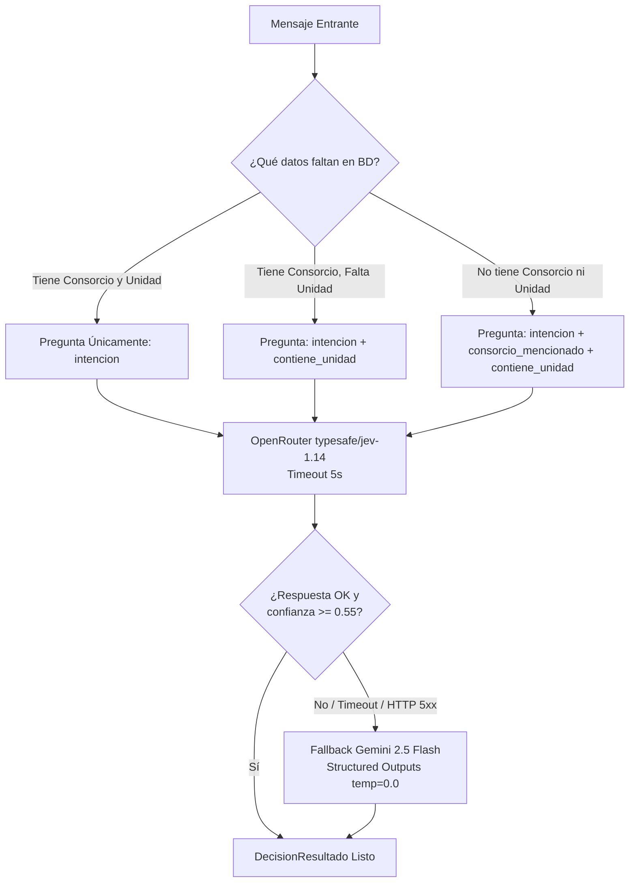

# Clasificador de Intenciones y Extractor Semántico con IA

Este documento especifica cómo se utiliza la Inteligencia Artificial de forma determinista, tipada y sin alucinaciones dentro del sistema de atención de la **Dra. Ivana Seliz Administraciones**.

---

## 1. Rol de la IA en la Arquitectura

Para garantizar un sistema **cero alucinaciones**, la IA no redacta respuestas abiertas al vecino. Su función está estrictamente acotada a:

1. **Router de Decisión Tipado (`OpenRouterClient`):**
   - Infiere la intención del usuario a partir de un conjunto cerrado de intenciones de negocio.
   - Aplica cortocircuito de preguntas según los datos faltantes en la base de datos (`has_consorcio`, `has_unidad`).
   - Devuelve un objeto tipado `DecisionResultado` con probabilidad de confianza y latencia.
2. **Extractor de Entidades y Normalización (`semantic_extractor.py`):**
   - Si se detecta mención de unidad funcional (`contiene_unidad == Yes`), normaliza expresiones coloquiales rioplatenses (ej. *"vivo en el 4b"*, *"soy de planta baja a"*) a cadenas estandarizadas (*"4° B"*, *"PB A"*).
   - Identifica menciones de calles y edificios administrados sin exponer el padrón general.
3. El motor determinista `ConversationFSM` recibe el objeto tipado y selecciona la plantilla oficial aprobada correspondiente.

---

## 2. Catálogo Cerrado de Intenciones (`Intencion`)

Definido en `apps/chatbot/src/engine/state_models.py`:

| Clave de Intención | Descripción y Criterio de Activación |
| :--- | :--- |
| `EMERGENCIA` | Riesgo edilicio grave: incendio, personas atrapadas en ascensor, escape de gas, inundación de caño maestro. |
| `CONSULTA_EXPENSAS` | Pedido de CBU, alias bancario, CUIT o datos de cuenta para pagar las expensas. |
| `AVISO_PAGO_REALIZADO` | Vecino indica que realizó una transferencia o remite comprobante de pago. |
| `RECLAMO_MANTENIMIENTO` | Averías en partes comunes: luces de palier quemadas, filtración, cerradura trabada, cochera. |
| `MUDANZA_O_REGLAMENTO` | Horarios de mudanza, solicitud de seguro de ART, reglamento de convivencia, SUM. |
| `TELEFONO_PORTERIA` | Pedido de teléfono o contacto del encargado / portería del edificio. |
| `CONSULTA_ADMINISTRACION` | Consultas administrativas varias (asambleas, certificados, atención en oficina). |
| `CIERRE_CORDIAL` | Agradecimientos y despedidas (*"gracias"*, *"ok"*, *"buen finde"*, *"👍"*). |
| `INTENCION_AMBIGUA` | Mensajes difusos, ambiguos o cuya confianza es inferior a 0.55. |

---

## 3. Lógica de Cortocircuito y Clasificación Híbrida

El cliente `OpenRouterClient` evalúa qué información ya posee el contacto en PostgreSQL antes de formular el prompt a la IA:



---

## 4. Normalización de Unidades Funcionales

Cuando `contiene_unidad == True`, se ejecuta la normalización semántica en `semantic_extractor.py`:

| Entrada del Vecino | Cadena Normalizada Guardada en BD |
| :--- | :--- |
| *"vivo en el 4b"* / *"cuarto be"* | `"4° B"` |
| *"soy de planta baja a"* / *"pb a"* | `"PB A"` |
| *"segundo c"* / *"2 c"* | `"2° C"` |
| *"piso dos depto cuatro"* | `"2° 4"` |
| *"cochera 12 subsuelo"* | `"Cochera 12"` |
| *"séptimo 7"* | `"7° 7"` |

---

## 5. Esquema Tipado de Salida (`DecisionResultado`)

```python
class DecisionResultado(BaseModel):
    intencion: str = Field(description="Clave de intención tipada")
    confidence: float = Field(ge=0.0, le=1.0, description="Probabilidad de acierto")
    consorcio_mencionado: Optional[str] = Field(None, description="Nombre normalizado del consorcio si fue detectado")
    contiene_unidad: bool = Field(False, description="True si el mensaje contiene piso/depto")
    unidad_extraida: Optional[str] = Field(None, description="Unidad normalizada ej: '4° B'")
    latency_ms: float = Field(0.0, description="Tiempo de inferencia en milisegundos")
    model_used: str = Field("typesafe/jev-1.14", description="Modelo que resolvió la clasificación")
```
