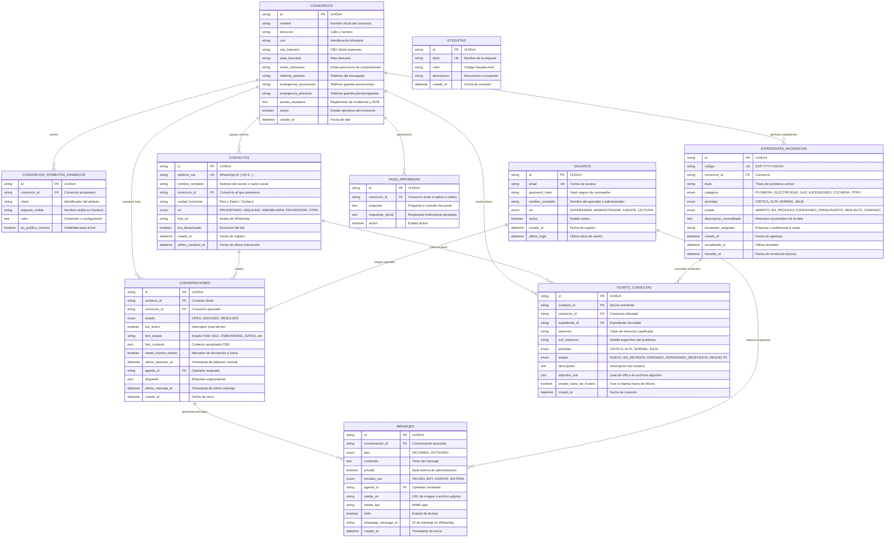

# Modelo de Datos y Diagrama Entidad-Relación (PostgreSQL)

Este documento describe la estructura relacional de la base de datos PostgreSQL del sistema de administración de consorcios **Dra. Ivana Seliz Administraciones**, gestionada mediante **SQLAlchemy 2.0 Async** en `apps/api/src/infrastructure/models.py`.

---

## 1. Diagrama Entidad-Relación (DER)

---

## 2. Índices de Rendimiento y Claves Únicas

Para asegurar latencias sub-segundo en PostgreSQL con cientos de conversaciones activas:

1. **`contactos.telefono_wa`:** Índice único (`UNIQUE INDEX`), acceso en $O(1)$ en la ingesta del webhook.
2. **`conversaciones.contacto_id` y `conversaciones.consorcio_id`:** Índices foráneos con cascada controlada.
3. **`conversaciones.ultimo_mensaje_el`:** Índice descendente para ordenar de inmediato la bandeja de entrada del inbox sin scan de tabla completa.
4. **`conversaciones.needs_human_review`:** Índice booleano para filtrar en milisegundos las conversaciones que requieren atención de Ivana a las 10:00 hs.
5. **`mensajes.conversacion_id` y `mensajes.creado_el`:** Índice compuesto para carga secuencial instantánea del historial en `MessageThread`.
