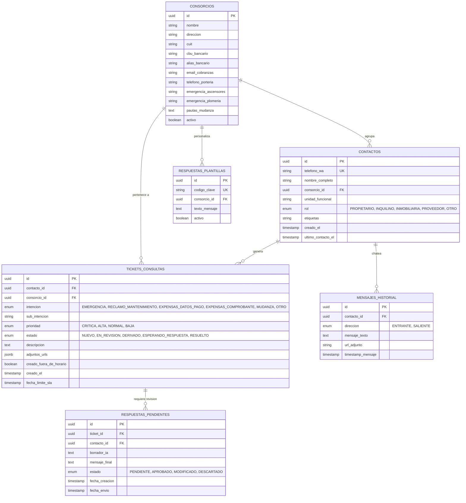

# Modelo de Datos y DER (NocoDB / PostgreSQL)

Este documento describe la estructura relacional de datos diseñada para implementarse en **NocoDB (LXC 192.168.1.94)** sobre PostgreSQL.

---

## 1. Diagrama Entidad-Relación (DER)

---

## 2. Detalle de Tablas y Atributos

### 1. `consorcios`
Almacena la configuración de cada edificio administrado para desacoplar los datos bancarios y teléfonos de guardia del código del bot.
- **Campos principales:**
  - `nombre`: Ej. *"Consorcio Corrientes y Lavalle"* (abarca Torre Corrientes, Torre Lavalle, Cocheras y Galería) o *"Consorcio Callao 2334"*.
  - `cbu_bancario` / `alias_bancario`: Cuenta corriente del consorcio para que los propietarios paguen las expensas.
  - `email_cobranzas`: Casilla para envío de comprobantes contables.
  - `telefono_porteria`: Teléfono de línea o celular de la portería / encargado.
  - `emergencia_ascensores`: Teléfono de la empresa de mantenimiento de ascensores habilitada para ese edificio.
  - `emergencia_plomeria`: Guardia de desobstrucción / cañerías.

### 2. `contactos`
Base de vecinos clasificados. Permite reconocer al usuario en su siguiente interacción sin volver a preguntarle quién es.
- **Campos clave:**
  - `telefono_wa`: Identificador internacional WhatsApp (ej. `5491162483302`).
  - `rol`: `PROPIETARIO` o `INQUILINO` (clave para saber si tiene derecho a consultar balances contables o solo reclamos técnicos de unidad).
  - `etiquetas`: Coma-separated o etiquetas NocoDB (ej. `"prioridad_alta"`, `"consejo_propietarios"`).

### 3. `tickets_consultas`
El registro operativo de todas las gestiones solicitadas.
- **Campos clave:**
  - `prioridad`: Calculada automáticamente por el clasificador de IA (`CRITICA`, `ALTA`, `NORMAL`, `BAJA`).
  - `estado`: Flujo Kanban en NocoDB: `NUEVO` ➔ `EN_REVISION` ➔ `DERIVADO` ➔ `RESUELTO`.
  - `creado_fuera_de_horario`: Indicador booleano para priorizar la revisión a primera hora de las 10:00 AM.

### 4. `respuestas_plantillas` (Respuestas Aprobadas)
Asegura que el bot use los textos institucionales aprobados por la Dra. Ivana Seliz.
- Códigos estándar:
  - `BIENVENIDA_HORARIO`
  - `FUERA_HORARIO`
  - `EMERGENCIA_GENERAL`
  - `SOLICITAR_CONSORCIO`
  - `SOLICITAR_FOTO_RECLAMO`
  - `CONFIRMACION_TICKET`

### 5. `respuestas_pendientes` (Modo Asistido Nivel 2)
Permite a Ivana o a su equipo auditar antes de enviar respuestas generadas por IA ante preguntas complejas:
1. El clasificador redacta un borrador fundamentado en el caso.
2. Queda visible en una vista tipo Inbox en NocoDB.
3. Un botón o cambio de estado a `APROBADO` dispara el mensaje por Evolution API.
