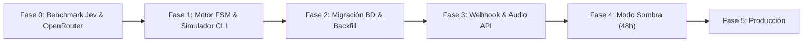

# Plan Maestro: Chatbot Consorcios — Administración Dra. Ivana Seliz
**Arquitectura:** Máquina de Estados Finitos (FSM) + Motor de Decisión Tipado (`typesafe/jev-1.14`) + LLM Extractor Confiable (`google/gemini-2.5-flash`)  
**Estado:** Especificación Validada Post-Grill (Lista para Implementación)  
**Fecha:** Octubre 2026

---

## 1. Respuestas Consolidadas del Relevamiento Técnico (Grill-Me)

A continuación se resumen los 20 puntos técnicos verificados directamente contra el código fuente (`apps/api/src/infrastructure/models.py`, `consorcio.db`, `.env`) y las decisiones acordadas:

### Bloque A: Esquema Exacto de Base de Datos
1. **Nombres de columnas en tabla `consorcios`:**
   - Nombre: `nombre` (String 255)
   - Dirección: `direccion` (String 255)
   - CUIT: `cuit` (String 30)
   - Datos bancarios: `cbu_bancario` (String 30), `alias_bancario` (String 50), `email_cobranzas` (String 100)
   - Teléfonos de guardia: `telefono_porteria` (String 50), `emergencia_ascensores` (String 50), `emergencia_plomeria` (String 50)
   - Pautas y estado: `pautas_mudanza` (Text), `activo` (Boolean)
2. **Estructura de teléfonos de guardia:**
   - Se encuentran divididos por gremio (`telefono_porteria`, `emergencia_ascensores`, `emergencia_plomeria`). Para las plantillas se consolidan en una presentación unificada clara y legible.
3. **Manejo de nulos en `consorcios`:**
   - Si un consorcio no tiene CBU o guardia específica, el resolver aplica un valor por defecto seguro que redirige cordialmente a la administración en horario de oficina.
4. **Formato telefónico en `contactos`:**
   - Columna `telefono_wa` en formato internacional E.164 (ej: `+5491144558899`). El webhook normaliza el JID de WhatsApp (`...7766@s.whatsapp.net`) al guardarlo en BD.

### Bloque B: Casos Borde y Unidades Funcionales
5. **Propietarios con múltiples unidades:**
   - Se mantiene inalterado el perfil principal en la tabla `contactos`. Si en un mensaje puntual consulta por otra unidad ("hablo por el 8° C"), la FSM atiende esa consulta específica en el contexto del chat sin sobrescribir el registro persistente.
6. **Nomenclatura de unidades:**
   - Soporta formato estándar de edificio argentino: `4° B`, `PB A`, `Cochera 14`, `Local 1`, `Baulera 3`.
7. **Edificios en esquina o calle dudosa (`OTRO_NO_ADMINISTRADO`):**
   - Ante la primera no coincidencia se solicita reconfirmar calle y altura exacta (útil para esquinas con doble numeración). Si vuelve a fallar, se despacha la plantilla de edificio fuera de administración.
8. **Emergencia sin consorcio identificado:**
   - Se proveen de inmediato los números de emergencia pública (Bomberos 100, Policía 911, SAME 107) y en el mismo mensaje se solicita la dirección del edificio para derivar la guardia correspondiente.

### Bloque C: Reglas de Conversación y Multimedia
9. **Doble intención (CBU + Reclamo):**
   - Se prioriza la entrega de datos bancarios para facilitar el pago y simultáneamente se marca `needs_human_review = True` asentando el reporte del desperfecto para la apertura del horario de oficina.
10. **Ventana de enfriamiento (Cooldown) en `IDLE`:**
    - Período de 5 minutos tras enviar un acuse formal. Si el usuario envía mensajes adicionales de agradecimiento o detalles menores, se registran en la base de datos sin disparar acuses reiterados.
11. **Adjunto mudo (Foto o PDF sin texto):**
    - Se despacha plantilla dual: aclara el canal de envío si se trata de un comprobante de expensas (vía correo de cobranzas) y confirma que si es constancia de un reclamo quedará asentada para evaluación.
12. **Límite de audio:**
    - Máximo 90 segundos. Audios de mayor duración o con transcripción ininteligible reciben la plantilla de solicitud de texto por escrito.

### Bloque D: Operación Nocturna y Takeover Humano
13. **Quiet Hours (00:00 a 07:30 hs):**
    - Silencio absoluto salvo emergencia crítica. Los mensajes nocturnos se persisten con `needs_human_review = True` para atención humana matutina, sin emitir respuestas programadas masivas a las 07:31 hs.
14. **Detección de Takeover (`fromMe: true`):**
    - Los IDs de mensajes emitidos por el bot se registran en Redis con TTL de 60s. Todo mensaje saliente en el webhook no reconocido en Redis se clasifica como intervención manual de Ivana, pausando el bot en ese chat por 12 horas.
15. **Reactivación de Takeover:**
    - Expiración automática a las 12 horas, con opción de reactivación mediante comando interno o panel.

### Bloque E: Infraestructura y Proveedores
16. **API de Audio:**
    - Groq API con modelo `whisper-large-v3-turbo` (latencia típica < 350 ms, bajo costo y nulo consumo de CPU del servidor).
17. **LLM Extractor y Fallback:**
    - Google Gemini 2.5 Flash a través de OpenRouter (salida JSON estructurada, alta velocidad y bajo costo).
18. **Backfill inicial:**
    - Base de datos actual compacta (~8 conversaciones y ~29 mensajes), lo que garantiza una migración instantánea.
19. **Entorno de ejecución:**
    - FastAPI con SQLAlchemy Async y Redis (`redis.asyncio`), compatible con SQLite para desarrollo local y PostgreSQL para producción en Docker/LXC.

---

## 2. Hoja de Ruta Optimizada (Roadmap de Implementación)



- **Fase 0: Benchmark y Validación de Latencia (`scripts/benchmark_jev.py`)**
  - Implementación del cliente OpenRouter para `typesafe/jev-1.14` y Gemini 2.5 Flash.
  - Ejecución de 30 casos de prueba representativos del dialecto rioplatense (expensas, emergencias, reclamos, onboarding fraccionado).
  - Medición de percentiles de latencia (P50, P90) y verificación del umbral de confianza (0.55).

- **Fase 1: Motor de Estados Finitos (`engine/fsm.py` y `test_fsm_cli.py`)**
  - Modelado de datos de estado (`FSMState`, `FSMContext`, `DecisionResultado`).
  - Lógica de transiciones puras deterministas y catálogo de plantillas con selección Round-Robin (3 variantes, sin emojis).
  - Simulador interactivo en consola para validación manual de todos los caminos posibles.

- **Fase 2: Actualización del Modelo de Datos y Script de Backfill**
  - Incorporación de columnas de estado en `conversaciones` (`fsm_estado`, `fsm_contexto`, `needs_human_review`, `ultimo_takeover_at`).
  - Incorporación de `bot_desactivado` en `contactos`.
  - Ejecución de `scripts/backfill_profiles.py` para sincronizar contactos existentes.

- **Fase 3: Integración de Webhooks y Servicios Externos**
  - Conexión del webhook de Evolution API (`webhook/evolution_handler.py`).
  - Lógica de descarte temprano, debounce en Redis y filtro de Takeover.
  - Integración del transcriptor Groq Whisper API.
  - Retardo humano simulado (`composing` 1.5s - 3.0s) anti-ban.

- **Fase 4: Prueba en Modo Sombra (`BOT_SHADOW_MODE=True`)**
  - Registro de todas las decisiones y respuestas proyectadas en `fsm_audit.log` sin despachar a WhatsApp durante 48 horas.
  - Verificación de auditoría junto a Ivana.

- **Fase 5: Puesta en Producción**
  - Desactivación de modo sombra y monitoreo activo.

---

## 3. Diagrama del Pipeline de Procesamiento (Simplificado y Profesional)

Este diagrama reemplaza el flujo anterior de 14 pasos de Excalidraw, eliminando modelos pesados en CPU, dependencias de LangGraph y emojis:

```mermaid
flowchart TD
    subgraph ETAPA_1["1. Ingesta y Guardrails Tempranos"]
        MSG_IN["Mensaje Entrante (Evolution API)"] --> CHK_JID{"¿Es Grupo o Difusión?"}
        CHK_JID -- "Sí" --> DISCARD["Descarte Inmediato"]
        CHK_JID -- "No" --> REDIS_DEB["Redis Debounce (8-10s)"]
        
        REDIS_DEB --> CHK_BOT{"¿Bot Global Activo o Contacto Excluido?"}
        CHK_BOT -- "Inactivo / Excluido" --> SILENCE_OFF["Silencio Permanente"]
        CHK_BOT -- "Activo" --> CHK_TK{"¿Takeover Manual Activo? (< 12h)"}
        CHK_TK -- "Sí" --> SILENCE_TK["Silencio por Takeover"]
        CHK_TK -- "No" --> CHK_HORARIO{"¿Horario de Oficina? (y no Feriado)"}
        CHK_HORARIO -- "Sí" --> SILENCE_OFICINA["Silencio (Atención Humana)"]
        CHK_HORARIO -- "No (Fuera de Hora / Feriado)" --> NORM_MEDIA["Normalización Multimedia"]
        
        NORM_MEDIA -- "Audio <= 90s" --> GROQ_AUDIO["Groq Whisper API"]
        NORM_MEDIA -- "Imagen / PDF" --> FLAG_ATTACH["Adjunto Registrado"]
        NORM_MEDIA -- "Texto" --> PAYLOAD_READY["Texto Consolidado y Contexto"]
        GROQ_AUDIO --> PAYLOAD_READY
        FLAG_ATTACH --> PAYLOAD_READY
    end

    subgraph ETAPA_2["2. Control de Sesión y Clasificación Tipada"]
        PAYLOAD_READY --> CHK_ESCAPE{"¿Comando de Reinicio / Cancelar?"}
        CHK_ESCAPE -- "Sí" --> RESET_IDLE["Resetear a IDLE"]
        CHK_ESCAPE -- "No" --> CHK_TTL{"¿Inactividad > 2 Horas?"}
        CHK_TTL -- "Sí" --> RESET_TTL["Resetear Estado FSM a IDLE"]
        CHK_TTL -- "No" --> SHORT_CIRCUIT["Optimización de Preguntas según Perfil"]
        RESET_TTL --> SHORT_CIRCUIT
        
        SHORT_CIRCUIT --> JEV_CALL["Jev 1.14 (OpenRouter)"]
        JEV_CALL --> JEV_EVAL{"¿Respuesta Válida y Confianza >= 0.55?"}
        JEV_EVAL -- "Error o Timeout > 5s" --> LLM_FALLBACK["Fallback Gemini 2.5 Flash"]
        JEV_EVAL -- "Baja Confianza" --> INTENT_AMBIGUA["Intención Ambigua"]
        JEV_EVAL -- "Válido" --> CHK_UNIT{"¿Contiene Unidad Nueva?"}
        CHK_UNIT -- "Sí" --> GEMINI_UNIT["Extracción de Unidad (Gemini 2.5 Flash)"]
        CHK_UNIT -- "No" --> OBJ_DECISION["Decisión Consolidada"]
        LLM_FALLBACK & INTENT_AMBIGUA & GEMINI_UNIT --> OBJ_DECISION
    end

    subgraph ETAPA_3["3. Máquina de Estados y Despacho"]
        OBJ_DECISION --> EARLY_BIND{"¿Nuevos Datos de Consorcio o Unidad?"}
        EARLY_BIND -- "Sí" --> PERSIST_CONTACT["Actualizar Tabla Contactos"]
        EARLY_BIND -- "No" --> CHK_QUIET{"¿Quiet Hours (00:00 a 07:30) y no Emergencia?"}
        PERSIST_CONTACT --> CHK_QUIET
        
        CHK_QUIET -- "Sí" --> SILENCE_NIGHT["Persistir Mensaje con Revisión Pendiente"]
        CHK_QUIET -- "No" --> FSM_EXEC["Ejecución ConversationFSM"]
        
        FSM_EXEC --> SEL_TPL["Selección Round-Robin de Plantilla (3 Variantes)"]
        SEL_TPL --> AUDIT_LOG["Registro en fsm_audit.log"]
        AUDIT_LOG --> CHK_SHADOW{"¿Modo Sombra Activo?"}
        CHK_SHADOW -- "Sí" --> FIN_SHADOW["Fin (Sin Enviar)"]
        CHK_SHADOW -- "No" --> SEND_WA["Retardo Composing (1.5-3.0s) y Envío Evolution API"]
    end
```



---

## 4. Diagrama de Estados FSM y Ciclo de Vida del Chat

Este diagrama detalla cómo evoluciona internamente la conversación y cómo se comportan los estados (`IDLE`, `ONBOARDING_DATOS`, `SOLICITANDO_EDIFICIO`, `ESPERANDO_SOLO_UNIDAD`) ante cada tipo de mensaje:

```mermaid
stateDiagram-v2
    [*] --> IDLE

    state IDLE {
        description: Estado base en reposo. Contacto con perfil completo o esperando inicio de consulta.
    }

    state ONBOARDING_DATOS {
        description: Se solicitó edificio y unidad funcional al vecino nuevo.
    }

    state SOLICITANDO_EDIFICIO {
        description: Se solicitó únicamente la dirección del consorcio (para CBU o Emergencia).
    }

    state ESPERANDO_SOLO_UNIDAD {
        description: Consorcio ya identificado; falta piso y depto para completar el registro.
    }

    %% Transiciones desde IDLE
    IDLE --> IDLE: CIERRE_CORDIAL / Silencio Inteligente
    IDLE --> IDLE: INTENCION_AMBIGUA / Plantilla de aclaración
    IDLE --> IDLE: EMERGENCIA_GRAVE (con Consorcio) / Envía teléfonos de guardia
    IDLE --> SOLICITANDO_EDIFICIO: EMERGENCIA_GRAVE (sin Consorcio) / Envía 100/107 y pide edificio
    IDLE --> IDLE: CONSULTA_EXPENSAS (con Consorcio) / Envía CBU y datos bancarios
    IDLE --> SOLICITANDO_EDIFICIO: CONSULTA_EXPENSAS (sin Consorcio) / Guarda pending_intent=EXPENSAS
    IDLE --> IDLE: AVISO_PAGO_REALIZADO / Recuerda envío de comprobante por correo
    IDLE --> IDLE: RECLAMO_TECNICO / MUDANZA (con Perfil Completo) / Acuse formal (needs_human_review=True)
    IDLE --> ONBOARDING_DATOS: RECLAMO_TECNICO / MUDANZA (sin Consorcio ni Unidad) / Pide ambos datos
    IDLE --> ESPERANDO_SOLO_UNIDAD: RECLAMO_TECNICO / MUDANZA (con Consorcio, sin Unidad) / Pide solo unidad

    %% Transiciones desde ONBOARDING_DATOS
    ONBOARDING_DATOS --> IDLE: Proporciona Consorcio y Unidad / Retoma intención pendiente -> CBU o Acuse
    ONBOARDING_DATOS --> ESPERANDO_SOLO_UNIDAD: Proporciona solo Consorcio / Guarda consorcio_id y pide unidad
    ONBOARDING_DATOS --> ONBOARDING_DATOS: Falla intento 1 (retry_count=1) / Pide calle y altura
    ONBOARDING_DATOS --> IDLE: Falla intento 2 (retry_count>=2) / Bailout a atención humana (10:00 hs)
    ONBOARDING_DATOS --> IDLE: Menciona Edificio No Administrado / Informa fuera de padrón

    %% Transiciones desde SOLICITANDO_EDIFICIO
    SOLICITANDO_EDIFICIO --> IDLE: Proporciona Consorcio válido / Retoma pending_intent (Expensas o Emergencia)
    SOLICITANDO_EDIFICIO --> SOLICITANDO_EDIFICIO: Falla intento 1 (retry_count=1) / Reitera pedido de dirección
    SOLICITANDO_EDIFICIO --> IDLE: Falla intento 2 (retry_count>=2) / Bailout a atención humana
    SOLICITANDO_EDIFICIO --> IDLE: Menciona Edificio No Administrado / Informa fuera de padrón

    %% Transiciones desde ESPERANDO_SOLO_UNIDAD
    ESPERANDO_SOLO_UNIDAD --> IDLE: Proporciona Unidad / Guarda unidad en contactos y retoma intención
    ESPERANDO_SOLO_UNIDAD --> ESPERANDO_SOLO_UNIDAD: Falla intento 1 (retry_count=1) / Reitera formato (piso y depto)
    ESPERANDO_SOLO_UNIDAD --> IDLE: Falla intento 2 (retry_count>=2) / Bailout a atención humana

    %% Reglas transversales de reinicio y expiración
    ONBOARDING_DATOS --> IDLE: Comando Escape ('0', 'menu', 'cancelar', 'inicio')
    SOLICITANDO_EDIFICIO --> IDLE: Comando Escape
    ESPERANDO_SOLO_UNIDAD --> IDLE: Comando Escape
    ONBOARDING_DATOS --> IDLE: Expiración TTL (Inactividad > 2 horas)
    SOLICITANDO_EDIFICIO --> IDLE: Expiración TTL
    ESPERANDO_SOLO_UNIDAD --> IDLE: Expiración TTL
```

### Comportamiento Interno de los Campos de Conversación

| Campo en BD | Tipo | Comportamiento durante el Ciclo de Vida |
| :--- | :--- | :--- |
| `fsm_estado` | `String` | Determina qué nodo de la máquina procesa el mensaje entrante (`IDLE`, `ONBOARDING_DATOS`, `SOLICITANDO_EDIFICIO`, `ESPERANDO_SOLO_UNIDAD`). Se resetea a `IDLE` por TTL de 2 horas o comando de escape. |
| `fsm_contexto` | `JSONB` | Almacena temporalmente la intención en suspenso (`pending_intent`), el contador de reintentos (`retry_count`) y flags de adjuntos (`has_attachment`). Se limpia al transicionar a `IDLE`. |
| `needs_human_review`| `Boolean` | Se marca en `True` cuando entra un reclamo técnico, consulta general, mensaje nocturno de madrugada o cuando fallan los reintentos de onboarding. Permanece en `False` en trámites resueltos de forma automática (envío de CBU o aviso de pago). |
| `ultimo_takeover_at`| `DateTime`| Se actualiza al timestamp actual cuando entra un mensaje saliente manual de Ivana (`fromMe: true` sin tracking del bot). Durante 12 horas, el bot silencia todas las respuestas automáticas para ese contacto. |
| `ultimo_mensaje_el` | `DateTime`| Marca la estampa del último mensaje recibido para calcular el vencimiento de sesión (TTL = 2 horas). |
