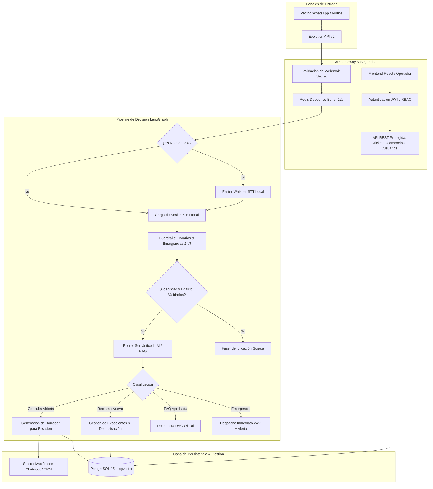

# Relevamiento Exhaustivo del Proyecto & Roadmap de Producción
**Sistema de Gestión Inteligente de Consorcios — Dra. Ivana Seliz**

---

## 1. Resumen Ejecutivo del Relevamiento

El proyecto cuenta con una base conceptual sólida y un stack moderno:
- **Backend**: FastAPI (Python 3.14 / 3.12 compatible) con SQLAlchemy asíncrono, LangGraph para orquestación de flujos de decisión, y conectores para Evolution API v2 (WhatsApp) y Chatwoot.
- **Frontend**: Vite + React 18 con Tailwind CSS y componentes modulares con Lucide Icons.
- **Modelos**: FastEmbed (`sentence-transformers/paraphrase-multilingual-MiniLM-L12-v2`) y modelo local Qwen 2.5 / Tev1 cuantizado a 4 bits (`GGUF`).

Sin embargo, para que el sistema opere en **producción real de forma seria, confiable y segura**, existen debilidades críticas en la lógica de decisión, gestión de expedientes, seguridad y ergonomía visual que provocan los fallos observados.

---

## 2. Diagnóstico Técnico de los Problemas Reportados

### A. Diagnóstico: "El TAV no anda casi nunca"
1. **El motor LLM local está desconectado en el código**:
   - En [`tev1_router.py`](file:///run/media/fabrizio/Almacenamiento/Works/Proyects/consorcio-seliz/apps/chatbot/src/services/tev1_router.py#L16-L25), la clase `Tev1Router` declara `self._llm = None` y verifica `os.path.exists()`, pero **jamás inicializa `llama-cpp-python` ni ejecuta inferencia con el archivo `tev1-0.8b-q4_k_m.gguf`**.
   - En su lugar, recurre a comparaciones de cadenas estáticas (`if any(token in msg_lower)`).
2. **Bloqueo por guardrail de horarios (Silencio estricto)**:
   - [`schedule_evaluator.py`](file:///run/media/fabrizio/Almacenamiento/Works/Proyects/consorcio-seliz/apps/chatbot/src/guardrails/schedule_evaluator.py#L39-L56) silencia completamente el bot durante el horario de oficina humano (Lunes a Viernes de 10:00 a 18:00 hs, Sábados de 10:00 a 13:00 hs) y durante *Quiet Hours* nocturnas (00:00 a 07:30 hs).
   - Al realizar pruebas en horario diurno habitual sin el flag `OVERRIDE_SCHEDULE_OFF_HOURS=true`, el bot no emite ninguna respuesta, dando la apariencia de caída o fallo total.
3. **Ausencia del procesador de notas de voz (Whisper)**:
   - Gran parte de las consultas y reclamos de vecinos ingresan como audios de WhatsApp. En [`webhook_evolution.py`](file:///run/media/fabrizio/Almacenamiento/Works/Proyects/consorcio-seliz/apps/api/src/api/v1/webhook_evolution.py#L210-L220), si `text` está vacío (mensaje de audio o sticker), el webhook se descarta de forma silenciosa sin transcribir.

### B. Diagnóstico: "El árbol de decisión devuelve respuestas random"
1. **Colisiones semánticas por palabras clave aisladas**:
   - En [`tev1_router.py`](file:///run/media/fabrizio/Almacenamiento/Works/Proyects/consorcio-seliz/apps/chatbot/src/services/tev1_router.py#L60-L64), si el mensaje contiene la palabra *"cuenta"* o *"pagar"* (por ejemplo: *"Tengan en cuenta que el ascensor hace ruido"* o *"No puedo pagar un flete por escalera si no anda el ascensor"*), se enruta erróneamente a `B_PAYMENTS` y envía CBU y datos de expensas.
2. **Coincidencias forzadas de atributos dinámicos**:
   - En [`graph.py`](file:///run/media/fabrizio/Almacenamiento/Works/Proyects/consorcio-seliz/apps/chatbot/src/engine/graph.py#L206-L239), se buscan subcadenas mayores a 4 letras sin contexto gramatical. Si el consorcio tiene un atributo `horario_retiro_basura`, cualquier mención casual a *"basura"* dispara una respuesta de atributo en lugar de registrar un reclamo.
3. **Ausencia de memoria conversacional (Arquitectura sin estado previo)**:
   - El árbol evalúa cada mensaje como un evento atómico y aislado. Si el bot solicita: *"¿Podrías indicarnos tu unidad funcional o departamento?"* y el vecino responde *"3° B"*, el árbol evalúa *"3° B"* de cero, lo categoriza como ruido o consulta neutra y no asocia la unidad al ticket en curso.

### C. Diagnóstico: "Se crean expedientes sin algo sólido y se duplican informes innecesariamente"
1. **Ventana de consolidación efímera de 120 segundos**:
   - En [`webhook_evolution.py`](file:///run/media/fabrizio/Almacenamiento/Works/Proyects/consorcio-seliz/apps/api/src/api/v1/webhook_evolution.py#L116-L158), el sistema solo anexa mensajes a un ticket existente si ingresaron dentro de los últimos 120 segundos (`cutoff = datetime.utcnow() - timedelta(seconds=120)`).
   - Si un vecino escribe una aclaración 3 minutos más tarde, el sistema genera un segundo ticket independiente.
2. **Tickets sin entidad jurídica ni edificio validado ("sin algo sólido")**:
   - Ante cualquier número desconocido, se crea un contacto al vuelo con rol `OTRO`, `consorcio_id = None`, `unidad_funcional = None`. Se abre un ticket huérfano sin edificio, sin unidad y sin categorización verificada.
3. **Inexistencia de un agrupador de incidentes (Incidencias vs Tickets)**:
   - Si 8 vecinos de una misma torre reportan que no funciona el ascensor principal, se generan 8 tickets redundantes en vez de vincularlos a un **Expediente de Incidencia Edilicia** común.

### D. Diagnóstico: "No hay login ni usuarios"
1. **API desprotegida**:
   - Los endpoints de `/api/v1/tickets`, `/api/v1/consorcios`, `/api/v1/contactos` y `/api/v1/debug` no implementan autenticación ni autorización (no hay JWT, OAuth2, ni validación de cabeceras `Authorization`).
2. **Sin entidad `User` en la base de datos**:
   - No existe un modelo relacional para usuarios del sistema con roles (`SUPER_ADMIN`, `ADMINISTRADORA`, `OPERADOR_GUARDA`, `LECTOR`).
3. **Frontend sin pantalla de autenticación ni estado de sesión**:
   - La aplicación asume automáticamente la sesión de la "Dra. Ivana Seliz" sin validar credenciales ni permisos de operación.

### E. Diagnóstico: "Ergonomía visual y menús rígidos (Apertura por proximidad)"
1. **Sidebar desktop fijo y estático**:
   - El sidebar ocupa un ancho fijo de 288px (`w-64 xl:w-72`) de forma constante, reduciendo el espacio útil para la gestión de tickets y chats en resoluciones de pantalla estándar de escritorio o notebooks.
   - No cuenta con modo colapsable compacto a iconos ni con **apertura por proximidad** (hover flotante inteligente al acercar el cursor al margen izquierdo).
2. **Inbox con distribución fija**:
   - La lista de conversaciones no se puede replegar/ocultar para maximizar el hilo de mensajes y el borrador de respuesta.
   - El panel de borrador de IA (`AiDraftBox`) no cuenta con botón de minimizar/acordeón.

---

## 3. Plan de Limpieza y Depuración del Repositorio

Se identificaron archivos redundantes, duplicados y desalineados que deben ser depurados para dejar el código limpio y preparado para despliegue:

| Elemento | Ubicación | Estado / Problema | Acción Recomendada |
| :--- | :--- | :--- | :--- |
| **Script Seed duplicado** | [`apps/api/src/seed.py`](file:///run/media/fabrizio/Almacenamiento/Works/Proyects/consorcio-seliz/apps/api/src/seed.py) | Redundante. [`infrastructure/seed.py`](file:///run/media/fabrizio/Almacenamiento/Works/Proyects/consorcio-seliz/apps/api/src/infrastructure/seed.py) es el oficial importado por `main.py`. | **Eliminar** `apps/api/src/seed.py`. |
| **Config Tailwind duplicada** | [`apps/frontend/tailwind.config.ts`](file:///run/media/fabrizio/Almacenamiento/Works/Proyects/consorcio-seliz/apps/frontend/tailwind.config.ts) | Conflicto. El frontend opera con JS puro (`tailwind.config.js`). | **Eliminar** `tailwind.config.ts`. |
| **Bases de datos SQLite en raíz** | `consorcio.db`, `test_api.db` | Archivos binarios locales de prueba en la raíz del proyecto. | **Mover a carpeta de datos** o limpiar de la raíz. |
| **Configuración pytest** | Raíz del proyecto | Falta `pytest.ini` o `pyproject.toml`; tests fallan sin `PYTHONPATH`. | **Crear** `pytest.ini` con `pythonpath = apps/api/src apps/chatbot/src`. |
| **Documentación desactualizada** | `docs/` | Contradicciones entre el rol de NocoDB vs Frontend React propio. | **Consolidar** en una guía de arquitectura unificada. |
| **Directorio dist generado** | `apps/frontend/dist` | Build generado en el árbol de código. | **Asegurar exclusión** en `.gitignore`. |

---

## 4. Arquitectura Objetivo para Producción

---

## 5. Especificación de Nuevas Implementaciones Clave

### 5.1. Módulo de Autenticación, Usuarios y Permisos (RBAC)
- **Modelos relacionales**:
  - `UserModel`: `id`, `email`, `hashed_password`, `nombre_completo`, `rol` (`SUPER_ADMIN`, `ADMINISTRADOR`, `OPERADOR`, `AUDITOR`), `activo`, `ultimo_login`.
  - `UserConsorcioPermission`: Asignación de edificios permitidos por operador (multi-tenancy de consorcios).
- **Seguridad**:
  - Hashing de contraseñas con `bcrypt`.
  - Emisión de tokens de acceso JWT (Access Token 15 min + Refresh Token en cookie HttpOnly 7 días).
  - Middleware de FastAPI que inyecta `current_user` y valida roles en cada endpoint.
- **Frontend**:
  - Pantalla de inicio de sesión sobria e institucional.
  - Persistencia de sesión y cierre automático por inactividad.

### 5.2. Ergonomía de Menús: Sidebar Colapsable con Apertura por Proximidad
- **Comportamiento UX**:
  1. **Modo Fijo Expandido (Pinned)**: Sidebar de 280px con texto e iconos para navegación cómoda.
  2. **Modo Colapsado (Compacto)**: Se reduce a 68px mostrando únicamente los iconos centrados con tooltips de ayuda.
  3. **Apertura por Proximidad (Hover Peek)**: Estando colapsado, al desplazar el cursor dentro de un margen de activación en el extremo izquierdo (o sobre los iconos), el menú se despliega automáticamente en overlay flotante suave con `z-index` elevado, permitiendo interactuar con todas las etiquetas completas sin desplazar la grilla central. Al retirar el mouse, vuelve de inmediato a modo compacto.
  4. **Persistencia**: Estado guardado en `localStorage` (`sidebar_collapsed: true/false`).
  5. **Inbox con Colapso Lateral**: Botón de minimizado para contraer la lista de chats y dejar el hilo de conversación y el borrador de respuesta en ancho completo.

### 5.3. Motor de Decisión Robusto (TAV & RAG)
- **Carga real del modelo local**:
  - Integrar `llama-cpp-python` en `Tev1Router` con `temperature=0.1`, ejecutando inferencia sobre el modelo cuantizado `models/tev1-0.8b-q4_k_m.gguf` para clasificación semántica estricta en JSON sin alucinaciones.
- **Integración con Whisper STT**:
  - Módulo para descargar notas de voz de Evolution API (`audio/ogg`, `audio/mp4`) y transcribir con `faster-whisper` en CPU multi-hilo antes de ingresar al pipeline.
- **Memoria de Diálogo en Redis / PostgreSQL**:
  - Mantenimiento del contexto de conversación (últimos 5 turnos de diálogo) para resolver preguntas de seguimiento como indicaciones de departamento, confirmaciones y aclaraciones.

### 5.4. Arquitectura de Expedientes e Incidentes (Cero Informes Duplicados)
- **Modelo de Expedientes (`IncidenciaEdiliciaModel`)**:
  - Separa el concepto de **Ticket/Mensaje** del concepto de **Expediente de Problema**.
  - Si 3 vecinos del mismo consorcio reportan un corte de agua o fallo de ascensor dentro de las últimas 24 horas, el sistema asocia los mensajes a un único **Expediente Activo** (`EXP-CORR-2026-0012`).
  - Permite cerrar el expediente y enviar una notificación masiva de resolución a todos los vecinos involucrados con un solo clic.
- **Validación de Identidad Obligatoria**:
  - El bot no genera expedientes de reclamo a números desconocidos hasta que se complete la verificación mínima:
    1. Selección / Detección del edificio.
    2. Identificación de unidad funcional (Piso/Depto).
    3. Rol (Propietario / Inquilino).
  - Si faltan datos, el bot solicita amablemente los datos faltantes antes de abrir la solicitud técnica.

---

## 6. Estado de Avance hacia Producción

### ✅ Fase 1: Limpieza, Normalización y Seguridad Base [COMPLETADA]
1. Limpieza de archivos redundantes (`seed.py`, `tailwind.config.ts`, `.db` residuales).
2. `pytest.ini` configurado para aislamiento limpio de tests y módulos.
3. Modelo relacional de usuarios (`UsuarioModel`), hashing bcrypt y JWT (`/api/v1/auth/login`, `/me`, `/usuarios`).
4. Pantalla de Login, interceptores de autenticación y protección de sesión en React.

### ✅ Fase 2: Ergonomía Visual y Rediseño de Layout [COMPLETADA]
1. Sidebar desktop colapsable a 68px con apertura por proximidad (hover peek flotante) y pin fijo.
2. Contracción ergonómica de lista de conversaciones y acordeón en borrador de IA.
3. Jerarquización tipográfica sobria institucional, botones e inputs ampliados.

### ✅ Fase 3: Extractor Semántico con LLM Local 3B (Opción B) [COMPLETADA]
1. Descargado y verificado `qwen2.5-3b-instruct-q4_k_m.gguf` (1.96 GB) en CPU multi-hilo local.
2. Módulo de extracción estructurada `SemanticExtractor` (`semantic_extractor.py`) con gramática JSON forzada.
3. Normalización de números hablados de Whisper ("cuarto be" -> "4° B", "planta baja a" -> "PB A").
4. Comprensión de modismos argentinos de expensas ("garpé", "alias", "cbu").
5. Detección semántica de emergencias críticas (inundación grave, ascensor trabado, cortocircuito con chispazos/humo) sin depender de palabras clave literales.
6. Fusión híbrida de seguridad (LLM + reglas deterministas de post-proceso para red de contención).
7. Blindaje de zona horaria de Buenos Aires (`America/Argentina/Buenos_Aires`) en `schedule_evaluator.py`.

### ✅ Fase 4: Arquitectura de Expedientes y Cero Duplicados [COMPLETADA]
1. Modelo relacional `ExpedienteIncidenciaModel` con código correlativo anual (`EXP-YYYY-XXXX`).
2. Consolidación de 24 hs en tickets del mismo contacto y agrupación en 48 hs de reclamos del mismo edificio bajo un único expediente.
3. Eliminación de notas privadas redundantes en Chatwoot.
4. Difusión masiva de actualizaciones de expedientes por WhatsApp (`/api/v1/expedientes/{id}/notificar-vecinos`).
5. Pestaña de Expedientes en Frontend con filtros por estado, categoría y detalle modal.

### ✅ Fase 5: Preparación de Despliegue en Servidor (Producción) [COMPLETADA]
1. Ingesta directa de notas de voz WhatsApp (`audioMessage`) con `faster-whisper` (CTranslate2 INT8) y `AudioTranscriber`.
2. `ffmpeg` incorporado en los Dockerfiles de API y Chatbot para decodificación de audio Opus.
3. Montaje de volumen `./models:/app/models` en el servicio `api` en `docker-compose.yml`.
4. Script de verificación y puesta en marcha con un solo comando: [`scripts/deploy_check.sh`](file:///run/media/fabrizio/Almacenamiento/Works/Proyects/consorcio-seliz/scripts/deploy_check.sh).
5. Sembrado inicial automático de base de datos (`seed.py`) con usuario Administrador, Operador y consorcios reales en el arranque del lifespan de FastAPI.
6. Suite completa de 55 tests pasando al 100% y build de Frontend verificado en 2.08s.

